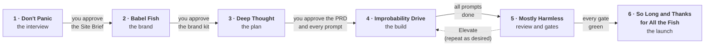
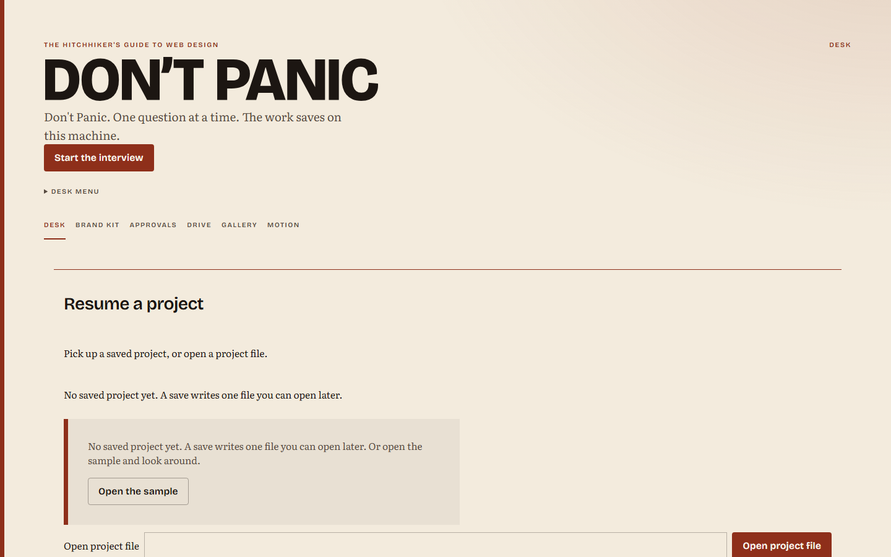
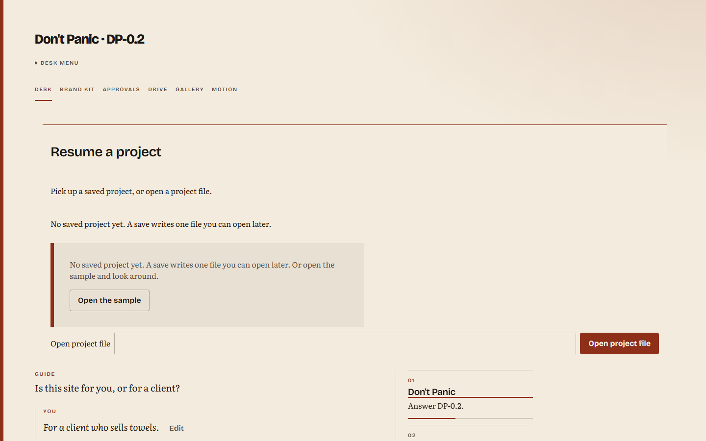
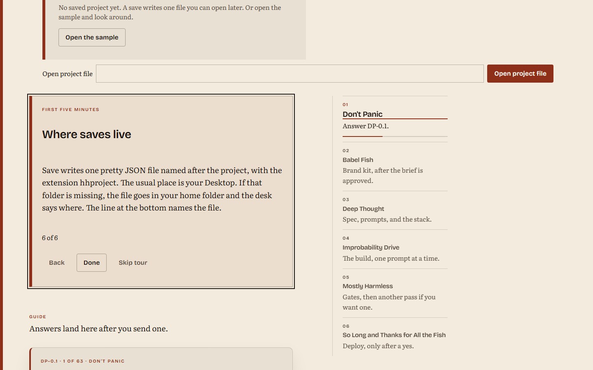
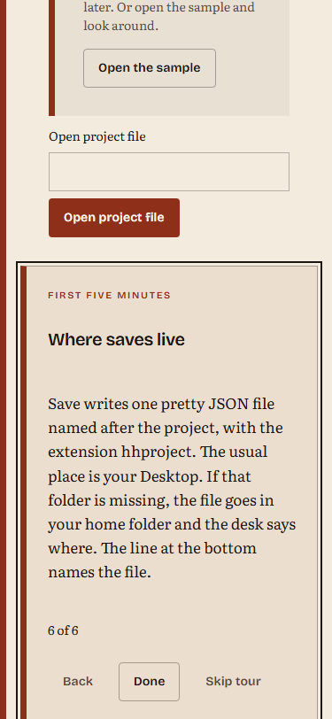

[banner]: docs/assets/banner.svg "Don't Panic."

<div align="center">

<picture>
  <source srcset="docs/assets/hero.png" media="(prefers-reduced-motion: reduce)">
  
</picture>

# The Hitchhiker's Guide to Web Design

**Don't Panic.** A free, open-source, spec-driven website builder that interviews you like the world's best brand agency,<br>then builds Awwwards-level sites with Grok 4.7.

[](LICENSE)
[](https://x.ai)
[](#built-on-gsd)
[](#roadmap)
[](https://github.com/kr8tiv-ai/hitchhikers-guide-to-web-design/actions/workflows/ci.yml)
<br>
[](#roadmap)

<br>

> ### *"Feels like a 2-hour meeting with the greatest brand agency on the planet,<br>using the greatest AI on the planet."*
> The north star, as set by Matt Haynes

<br>

[What it is](#what-is-this-exactly) ·
[How it works](#how-it-works-six-phases) ·
[The Guide](#meet-the-guide) ·
[Motion](#the-motion-toolkit) ·
[Anti-slop](#the-anti-slop-rules) ·
[Try it](#try-it) ·
[Quick start](#quick-start) ·
[Preview](#look-before-you-publish) ·
[Roadmap](#roadmap) ·
[FAQ](#faq)

</div>

<br>

## You've arrived early

Like, "the paint is still wet and the AI is holding the brush" early.

The Hitchhiker's Guide to Web Design is in this repo, now alpha, still being built by Grok 4.7 inside Grok Build, from a specification so thorough it has its own table of contents, its own research department and, at one point, its own opinion about kerning. The six phases are in the tree. The publishable CLI, `packages/cli`, is `0.1.0`. The private workspace root stays `0.0.0` and is not the package npm would receive. Alpha means the desk, the gates, and a local package exist. It does not mean the registry already has a release. Repository: [github.com/kr8tiv-ai/hitchhikers-guide-to-web-design](https://github.com/kr8tiv-ai/hitchhikers-guide-to-web-design).

Star the repo, watch it happen, and bring a towel. Things are about to get improbable.

---

## Try it

Node.js 22 or newer is the only thing you install yourself. There are two doors. Neither one asks for an account until you choose to publish a site, and neither one spends money on its own.

The alpha package entry, once it is on npm, is:

```
npx hitchhikers-guide
```

That command downloads `hitchhikers-guide` and starts the local desk. `npm i -g hitchhikers-guide` installs the same program, and the command after that is `hh`. `hh --version` should print `0.1.0`. A bare `hh`, with no subcommand, is that same desk.

The package in this repo is prepared at `0.1.0`. It is not on the public registry yet. Putting it there, and marking the commit with a `v0.1.0` tag, are human steps, and both need Matt's explicit yes. Until that yes, `npx hitchhikers-guide` has no release to fetch, and the clone below is the door that opens today. Do not npm publish from a build session, and do not create the tag from one.

From a fresh clone, one command installs the workspace and opens the desk:

```
node scripts/start.mjs
```

The desk prints a localhost URL and opens a browser. On an empty desk, choose **Open the sample**. Mostly Towels is a real project file, already answered once, with no secrets and no path from another machine. A short tour walks the desk, the sample, the brief, Suggest, the approval step, and where saves live. Skip tour puts it away. Replay tour brings it back.

`pnpm start` is the same command once this repo is the current directory.

The two-minute version, including why any of this is worth the towel, is [docs/PITCH.md](docs/PITCH.md). The longer install notes are still in [Quick start](#quick-start).

## What is this, exactly?

Most AI website builders work like a vending machine. You type "bakery website", something drops out of the slot, it has a purple gradient and three feature cards with icons, and everyone agrees to pretend this is fine.

This one works the other way round.

Before a single line of code is written, the Guide sits you down for a long, funny, slightly obsessive conversation, the kind a top brand agency would bill you a small moon for. It works out who you are, who you're for, what you want visitors to actually *do*, and what your site should *feel* like. Then it turns all of that into a real brand, a real spec and a stack of 50 to 150 carefully written build prompts. Finally it drives Grok 4.7 through every one of them, with a reviewer checking the work and a watchdog catching errors before you notice them.

**Simple questions go in. Very technical, award-calibre websites come out.**

| | |
|---|---|
| **Free and MIT-licensed** | Forever. No SaaS, no paywall, no "Pro" tier lurking behind a modal with a countdown timer. |
| **Local-first** | Runs on your own machine inside Grok Build, on your own SuperGrok plan. Your code, your repo, your hosting. |
| **Spec-driven to the bone** | Every decision lives in plain files modelled on [GSD](#built-on-gsd). Every build prompt runs in a fresh session. Nothing is left to vibes. |
| **Agency-grade discovery** | Brand, voice, positioning, goals, KPIs, competitors, SEO, taste, motion appetite, budget, deadline. The lot. |
| **Award-level output** | GSAP, Three.js, shaders and friends, applied with taste and policed by a strict anti-slop rulebook. |
| **You own everything** | Deploy wherever you like. Hostinger first, plus Vercel, Netlify and Cloudflare. |

**What it isn't:** a hosted builder, a drag-and-drop editor, a template store, or a paid SaaS. Think of it as an open-source agency in a box. The box contains a towel.

---

## Who it's for

**Beginners and new entrepreneurs.** You have an idea, a logo you sketched on a napkin, and no idea what ScrollTrigger is. Perfect. You're exactly who this was built for. The Guide explains every term in two sentences or fewer, offers *Suggest for me* on every single question, and puts real example sites in front of you instead of asking you to imagine them.

**Agencies.** You have clients, deadlines and a faint twitch whenever someone says "can we make it pop?" There's a condensed interview mode, you can import a client's brief or brand guide and skip straight to the gaps, and you get client-presentable PRDs and brand kits at the end. Several projects can live in one workspace.

**Designers and developers.** You know exactly what an easing curve is, and you have *feelings* about it. Every spec file is plain text you can edit. The framework choice is explained and overridable. Motion IDs, effort routing and the prompts themselves are all exposed. The Guide notices when you say "INP" or "R3F" and quietly stops explaining the basics.

**Everyone else.** Anyone who has looked at an AI-generated website and thought, "I have seen this exact page four hundred times." Welcome. You're among friends.

The very first thing the Guide asks is how comfortable you are with web stuff, on a scale from *towel-less hitchhiker* to *Slartibartfast*. It keeps adjusting as you talk, in both directions, without making a fuss about it.

---

## How it works: six phases

Every site travels through six phases. Each one ends with you approving something, and each new phase opens with a short **"Before we jump"** round of follow-up questions based on what the previous phase produced. ("Your brand says *calm*, but you picked motion level 9. Want a calm 9, or shall we talk about it?")



The dotted arrow belongs to the orchestrator. Elevate (repeat as desired) -> Drive puts each improvement you accept on the Drive queue as one prompt and one commit. Accept nothing, and the queue gains nothing and no commit is made.

The six names on the map stay the names you see. The orchestrator also keeps one shorter list, and every move goes through that one table: discovery, brief, design, build, Elevate, and So long. Discovery is the interview. Brief is the Site Brief. Design covers the brand and the plan. Build is the Drive. Elevate is the review. So long is the launch. A step can stay, go forward one, or go back one. It cannot skip.

The brief command, the Elevate command, the so-long command, the build command on resume, and the next command on run, along with the desk buttons for the draft, the approval, the design stages, and Start build, all ask that table before they move. A command that would skip stops, and the sentence names the step that is still open. One of those sentences is "Finish the brief before building." Publishing still runs the quality check after the table says the launch is the next step. A blocked check still cannot go live.

A folder with no saved phase is treated as standing on the step just before a command that does not publish, so the first honest command can begin. The quality check is never assumed, so a publish command on that same empty folder stops. Once `.hitchhiker/flow.json` is written, the next command reads it and cannot skip ahead of that saved step. A quality-check file means the check has been reached, so publish is the next step only when the project has not started or is already in the build, and the check still has to pass. A project that is still in the interview is not jumped ahead by that file. The yes on the Launch card records that you mean to launch. It does not publish, and it does not move the saved step.

### 1. Don't Panic: the interview
> *The longest, most enjoyable meeting you will ever attend, and you can do it in your pyjamas.*

A deep, skippable interview: your experience and any previous sites, brand and assets, why the site exists, what counts as success (sales, bookings, calls, leads, art, content, or several at once), the KPIs behind it, competitors (crawled for you), SEO and blogging, taste, motion appetite, 3D, budget, deadline and hosting. You can feed it PDFs, screenshots, website URLs, images, Pinterest boards, competitor sites and existing brand guides. It saves as you go and resumes whenever you come back. It finishes by writing a Site Brief and asking the most important question in design: *"What did I get wrong?"*

### 2. Babel Fish: the brand
> *Translates the noises you make about your business into a brand other people can understand.*

The why behind the business, archetype and positioning, ideal customer, palette, typography, imagery, and a full voice guide with slogans, tagline and banned words. The logo is made with Grok Imagine and delivered as a clean SVG. Weak images get graded, upscaled or replaced, because nobody needs a blurry hero. Already have a brand? Upload it and skip ahead. The Guide will still ask, "Happy with this?", and offer to make it better. It can be quite persuasive about that.

### 3. Deep Thought: the plan
> *Thinks extremely hard up front, so the build never has to guess.*

The PRD, requirements, roadmap, motion spec, section plan, visual direction and one genuinely massive context document. Grok picks the right framework for the job (Astro, Next.js, SvelteKit and so on), explains why, lists the alternatives and trade-offs, and lets you argue. Then it writes the whole prompt package, 50 to 150 prompts written specifically for Grok 4.7. You approve all of it before anything gets built.

### 4. Improbability Drive: the build
> *Makes the wildly improbable happen on schedule, one commit at a time.*

The orchestrator runs every prompt in a fresh Grok Build session, picking the model and effort level per prompt. One prompt is one job is one commit. Every three prompts the reviewer takes desktop and mobile screenshots, checks them against the spec and fixes what's off. The watchdog watches for errors and stalls, fixes the small stuff immediately, escalates only when it genuinely has to, and can roll back to the last reviewed commit. You get progress updates the whole way, and a proper reveal at the end.

On this repo, the prompt queue is walked by [`.hh-driver/run-build.ps1`](.hh-driver/README.md) on Windows and by `node .hh-driver/run-build.mjs` on macOS and Linux. Same rules: one prompt per session, a normal `git push`, never a force push. `/hh-drive` is a skill you type. It is not an `hh` subcommand.

### 5. Mostly Harmless: the review
> *We aim considerably higher than the name suggests.*

Hard quality gates, an anti-slop audit, and a jury of three Awwwards-style judges scoring design, usability, creativity and content, with strict instructions that if it's a 6, they say 6. Then comes the [Elevate loop](#the-elevate-loop), which you can run as many times as you like.

### 6. So Long and Thanks for All the Fish: the launch
> *Your site leaves the nest. We wave a small, sentimental towel.*

Deploys to Hostinger, Vercel, Netlify or Cloudflare with your explicit go-ahead, and writes a `DEPLOY.md` with the manual steps too. Then it runs post-deploy checks on the live site, puts together a launch kit (OG images, launch posts in your brand voice, an announcement email), writes a handoff doc, and leaves you a ranked list of post-launch upgrades for when you're ready for round two.

Before any of that, you can look at the built pages on this computer. The preview picks a free port, leaves the desk's port alone, and writes a zip of those pages under `.hitchhiker/deploy/`. No account, no keychain, and nothing leaves the machine. A site that still needs a server to answer each visit is told so, in plain language, instead of being pretended into a folder of pages. The details are in [Look before you publish](#look-before-you-publish).

The command for that moment is `hh so-long --project <dir>`. It reads the quality check for the version you have now. If that check is missing, belongs to a different version, or is blocked, it stops and tells you why, and it does not call a host. When the check is clear, it recommends Hostinger and also offers to keep a preview on this computer. Nothing is published until you name the host and pass `--yes`. The walkthrough is in [Publish with hh so-long](#publish-with-hh-so-long).

After a publish that actually runs, the same command can check the live address and write the result under the deploy row. A preview on this computer costs nothing. Publishing to a host uses that host's plan. The Approvals page on the desk has a Launch card that says this before you record a yes. Recording the yes does not publish by itself.

### The crew

| Name | Job | Personality |
|---|---|---|
| **The Guide** | Interviewer | Funny, artsy, precise, kind, and impossible to fob off with "modern". |
| **Deep Thought** | Planner | Takes the big questions seriously so you don't have to. |
| **Eddie** | Orchestrator | Relentlessly cheerful progress updates. Has never once had a bad day. |
| **Zaphod** | Reviewer | Two heads, two viewports: desktop and mobile. Misses very little. |
| **Marvin** | Watchdog | Sees every error. Enjoys none of them. Fixes them anyway. |

---

## Meet The Guide

The interviewer is the heart of the whole thing, so it got a proper character sheet.

**The Guide is funny** in a dry, absurdist, never-mean way, at roughly one joke per three or four messages and never when you're stressed. **It's artsy**: it talks about light, rhythm, tension and negative space, and it gets visibly excited about good typography. **It's a bit autistic, on purpose and with affection**: literal precision ("When you say *modern*, do you mean 2026-modern, mid-century-modern or *Tron*-modern?"), a talent for spotting patterns ("You've said *calm* four times and sent me three neon sites. Let's talk about that."), deep special interests in kerning and easing curves, and info-dumps politely capped at three sentences with an offer to say more. **It's friendly and pushy**: it pushes back on vague answers every time, holds the line twice, then accepts your answer and notes it for later. **And it's kind about skipping.** Towels are optional, technically.

A taste of the conversation:

> **The Guide:** Right. Three words for how the site should *feel*. Not what it does. How it feels. (If you say "clean", I will gently lie down on the floor.)
>
> **You:** Clean, modern, premium.
>
> **The Guide:** I'm on the floor. Let's sharpen it. Is *premium* more like a quiet apothecary on warm paper, or more like a sports car on a wet track at night? Or tap *Suggest for me* and I'll pull up four real sites and we'll walk through them together.

**House rules the Guide lives by:**

- **One question at a time.** No forms with forty fields. It's a conversation.
- **Every question has three answers:** `Answer` · `Suggest for me` · `Skip`. Skipped items get sensible defaults, clearly marked as assumptions in the spec so nothing sneaks through. On the card, a Suggest or a Skip that writes a stand-in is labelled `Assumed:`, and the kind is suggested or skipped. A required question asks you to choose Skip again before that assumption is written.
- **The card shows where you are.** The kicker is the question id, the index of the total, and the phase, plus how many required questions are still open, and the interview mode. The client does not recount.
- **"Suggest for me" is grounded.** Two to four concrete options based on everything it already knows about you. For taste questions it pulls real example sites (two from Godly, two from Awwwards) as clickable links and walks you through what's happening in each one.
- **It mirrors you back.** Every eight questions or so you get a three-line "here's what I think I heard".
- **It never lectures.** Two sentences of explanation for beginners, none at all for pros.
- **It speaks your language.** Literally. Talk to it in Spanish and it replies in Spanish.

---

## Talk to it

You can talk the whole way through. Click the voice button, ramble about your business like you would to a friend at a bar, then click it again. Plenty of the best brand insights hide in rambling. Stopping keeps the words in the draft. The desk waits for the final result before it finishes, and nothing is submitted until you press Answer.

- **Browser speech (default, free to you).** When the browser exposes speech recognition, the desk uses it. The label reads `Voice: browser (free)`. Chrome and Edge do this. The browser vendor processes the audio, so it may leave the machine. It does not spend an xAI key. The order is in [docs/voice.md](docs/voice.md).
- **Local whisper, when the browser cannot listen.** If speech recognition is missing and [whisper.cpp](https://github.com/ggml-org/whisper.cpp) is already installed, the label reads `Voice: local whisper`. The app does not download the binary or the weights.
- **xAI speech-to-text (optional).** The settings screen at `/settings` shows the rate before it can be turned on: $0.10 per hour for REST and $0.20 per hour for streaming. Both the xAI setting and the accepted rate have to be on. Otherwise speech stays on the browser, then local whisper, then typing. The paid path that ships is REST. This client does not open the streaming socket. The same screen holds the model and the effort for the project.
- **The Guide replies in text.** That saves your tokens, you can skim it, and frankly the Guide types faster than it talks.

---

## Difficulty tiers

Every build prompt gets a difficulty tier, which decides how much brainpower it receives. Easy work gets medium effort; hard work gets high or extra-high. You can override any of it, globally or per prompt.

| Tier | Name | Typical work | Default effort | In a sentence |
|:---:|---|---|---|---|
| 1 | **Towel** | Config, file moves, credits entries, copy placement, small fixes | `medium` | Small, essential and wildly underestimated. |
| 2 | **Cup of Tea** | Simple sections, navigation, forms, SEO tags | `medium` | Comforting, familiar, and surprisingly hard to get exactly right. |
| 3 | **Gargle Blaster** | Motion systems, reveals, smooth scroll, transitions, integrations | `high` | Potent. Best handled by a model that has had a good night's sleep. |
| 4 | **Heart of Gold** | Scroll-scrubbed films, 3D scenes, shader work, complex responsive layouts | `high` / `xhigh` | Improbable on paper. Fortunately, there's a drive for that. |
| 5 | **Forty-Two** | The PRD, specs, the prompt package, the final once-over, Elevate | `xhigh` | The big questions. We made sure to write the question down first. |

---

## The motion toolkit

The Guide asks for your **motion appetite on a 1 to 10 scale**, describes each kind of effect in plain words, and shows you real examples before you choose. At level 1 your site breathes politely. At level 10 it becomes a full movie or a choose-your-own-adventure. Each site gets **exactly one signature moment**, and every heavy effect ships with a calm phone version and a reduced-motion version, because motion sickness is not a brand value.

**GSAP is the base engine**, including ScrollTrigger, SplitText, and the other free plugins. The toolkit ships all nine. The picker chooses per effect: CSS scroll-driven for a light reveal, GSAP for sequenced scroll and text splits, Three.js for a 3D scene, raw WebGL and GLSL via OGL or WebGL2 for a shader, Theatre.js core (`@theatre/core` only) for a cinematic timeline, Motion or anime.js for a gesture or a small timeline, and vanilla JS when the effect should stay small. Lenis can drive ScrollTrigger as one scroll source, and Three.js, Theatre.js core, and the shader work can share one render loop. There is no second engine. Generated sites import only what they use, so phones stay fast.

| Tool | What it's for | When the Guide reaches for it |
|---|---|---|
| **[GSAP](https://gsap.com)** (base engine; ScrollTrigger, SplitText, and the other free plugins) | The precision timeline engine of the web | Masked line reveals, pinned story sections, scroll-scrubbed sequences, layout morphs |
| **[Three.js](https://threejs.org)** | Real-time 3D in the browser | HDRI-lit models, product moments and whole worlds, lazy-loaded with mobile stills |
| **Raw WebGL / GLSL shaders** (OGL or WebGL2) | Custom pixels, written by hand | Backgrounds, distortion and transitions when nothing off the shelf is strange enough |
| **[Motion](https://motion.dev)** (formerly Framer Motion) | Springs, gestures and layout animation | React islands, interactive components, physical-feeling UI |
| **[anime.js](https://animejs.com)** | Lightweight, MIT-licensed animation | SVG line work, staggers and small timelines where a big engine is overkill |
| **[Theatre.js](https://www.theatrejs.com)** core (`@theatre/core` only) | Visual keyframing and choreography | Cinematic sequences and camera moves for the movie-style sites |
| **[Lenis](https://lenis.darkroom.engineering)** | Smooth scroll that respects the user | Silky scrolling wired into ScrollTrigger, with no scroll-jacking fights |
| **CSS scroll-driven animations** | Native, zero-JavaScript motion | Reveals, progress indicators and parallax that cost almost nothing on phones |
| **Vanilla JS** | The humble hero of the story | Intersection observers, View Transitions and every small touch that doesn't deserve a dependency |

| Appetite | What it feels like |
|:---:|---|
| 1-2 | Quiet confidence. Considered fades, beautiful type, nothing that moves without a reason. |
| 3-4 | Smooth scroll, line-by-line headline reveals, page transitions that feel expensive. |
| 5-7 | Pinned storytelling, scroll-scrubbed video, layout morphs, shader backgrounds. |
| 8-10 | Full 3D, physics, cinematic camera work. Movie sites and choose-your-own-adventures. |

---

## The anti-slop rules

Every AI site builder has a *look*. You know the one. You've scrolled past it this morning. This project keeps an explicit, enforced rulebook to make sure it never produces it.

**Never:**

- Magnetic buttons that chase your cursor around like an anxious puppy
- Purple-to-blue gradients, rainbow gradients, glowing aurora blobs behind the hero
- The centered hero with a floating abstract 3D shape that represents nothing
- The row of three feature cards with icons (you can picture it right now, can't you)
- Glassmorphism on every surface, bento grids as the answer to every layout question
- Emoji as icons, sparkles as decoration, rockets as a personality
- Fake "Trusted by" logo strips, invented testimonials, made-up numbers
- "Learn More" and "Get Started" buttons. A button should name what happens: "Book a tasting", "See the floor plans".
- Headlines like "Welcome to X" or "The all-in-one Y for Z"
- The default Tailwind look, Inter for everything, and every section in the same rhythm
- Lorem ipsum, stock photos of people pointing at laptops, and words like *unlock*, *seamless*, *revolutionize*, *leverage* and *delve*

**Always:**

- One bold idea per section, named out loud
- Real copy in the brand's own voice, specific and human
- Asymmetric layouts with intentional empty space
- A type scale with real contrast between display and body
- Motion with a purpose: it guides the eye, tells the story or gives feedback, and is never just decoration
- Details only *this* brand would have
- If you're about to do something you've seen on a thousand sites, stop and do the more interesting version

**Enforcement** is called the **Nutrimatic Test**. A fast static lint checks the copy for banned words, the CSS for forbidden palettes and gradients, and the scripts for cursor-chasing buttons. Then the reviewer uses Grok vision to look at the screenshots and spot centered blobs, three-card rows and monotonous rhythm. Every hit becomes a fix with a concrete alternative drawn from your brand and the motion library.

---

## Quality gates and the Elevate loop

A site isn't done when it looks done. It's done when it passes every gate.

| Gate | Bar |
|---|---|
| **Lighthouse (mobile)** | 90+ in Performance, Accessibility, Best Practices and SEO |
| **Core Web Vitals** | LCP ≤ 2.5 s, CLS ≤ 0.1, INP ≤ 200 ms target |
| **Console** | Zero errors and zero failed requests, across four viewport sizes |
| **Accessibility** | No serious or critical axe issues, keyboard navigation, focus handling, full reduced-motion support |
| **SEO** | Unique titles and meta, OG images, one H1 per page, alt text, sitemap, robots, canonical tags, structured data |
| **Links and assets** | No broken links, media within budget |
| **Credits** | Every borrowed font, model and texture properly credited |
| **Reviewer sign-off** | Brand score of at least 8/10 on every dimension, and *you* click Approve |

### The Elevate loop

Then comes the fun part. Press `/hh-elevate` and Grok 4.7, on extra-high effort, looks at your finished site cold and asks itself one question: **"How could I possibly improve this?"**

It comes back with upgrades ranked by impact against effort: type and spacing, motion, imagery, copy, or a standout feature. A visual pass may add a section treatment, an effect, or an image. You pick the ones you want, they run through the same reviewed build loop, every gate runs again, and nothing merges if a gate gets worse. Press it again. And again. There's a dedicated detail pass, **Slartibartfast's Fjords**, for the obsessive finishing touches: kerning, optical alignment, hover and focus states, the 404 page, the favicon. Somebody has to care about the fjords.

---

## Built on GSD

This project stands on the shoulders of **[GSD](https://github.com/open-gsd)**, and specifically **[open-gsd/gsd-core](https://github.com/open-gsd/gsd-core)** (MIT), a spec-driven development system that keeps AI builds honest. We copy its approach on purpose:

- **State lives in files**, not in a chat history that quietly evaporates.
- **Every step runs in fresh context**, so prompt 97 is as sharp as prompt 1.
- **Plans have must-haves**, and verification works backwards from the goal.
- **One prompt, one job, one commit.** Never "as before".

On top of GSD's spine (`PROJECT.md`, `REQUIREMENTS.md`, `ROADMAP.md`, `STATE.md` and per-step `PLAN`, `SUMMARY` and `VERIFICATION` files), we add a brand and motion layer:

```text
.hitchhiker/
├── PROJECT.md            who you are, and how techy you turned out to be
├── SITE-BRIEF.md         the interview, distilled
├── BRAND.md              the brand brain: the constitution for every prompt
├── VOICE.md              how you talk, slogans included, banned words excluded
├── MOTION.md             your appetite, your signature moment, the calm phone version
├── VISUAL-DIRECTION.md   what it looks like, and what it must never look like
├── SECTION-PLAN.md       every section, its job, and its one bold idea
├── PRD.md                the full product requirements
├── REQUIREMENTS.md       (GSD)
├── ROADMAP.md            (GSD)
├── STATE.md              (GSD) the resume spine: close the laptop whenever you like
├── RULES.md              anti-slop and house rules, injected everywhere
├── ASSETS.md             what's real, what's generated, what's still to come
├── CREDITS.json          everything borrowed, properly credited
└── prompts/              50-150 build prompts, written for Grok 4.7
```

Snapshots of [gsd-core](vendor/gsd-core), [gsd-path](vendor/gsd-path), [gsd-pi](vendor/gsd-pi) and [gsd-spec-build-loop](vendor/gsd-spec-build-loop) live in [`vendor/`](vendor) for reference, each under its own MIT license (see [`vendor/VENDORED.md`](vendor/VENDORED.md)). `vendor/gsd-core` is templates. It is not a runtime dependency. Huge thanks to the Open GSD folks for proving that "spec first" and "fun" can live in the same sentence.

---

## What's in the repo today

The app is in the repo, and so is the brain it was built from. The root `package.json` is still `0.0.0` and private. The publishable CLI in [`packages/cli/package.json`](packages/cli/package.json) is `0.1.0`. `hh --version` reads the CLI file, not the root.

| Path | What it is |
|---|---|
| [`CONTEXT-PACKAGE.md`](CONTEXT-PACKAGE.md) | The master spec: vision, phases, interview tree, brand system, orchestration, gates, anti-slop rules, repo plan. Roughly 15,000 words of very specific opinions. |
| [`DECISIONS.md`](DECISIONS.md) | Locked product decisions that override anything else (for example, the full motion toolkit). |
| [`context/matt-answers.md`](context/matt-answers.md) | The forty answers that define what this should be. |
| [`context/research/`](context/research) | Twelve research reports plus a summary, from GSD internals to Awwwards anatomy to competitor gaps. |
| [`context/miro/`](context/miro) | The original interview skeleton, sketched on a whiteboard. |
| [`context/sources/`](context/sources) | Reference material: Matt's free AntiHero guides, Grok Build and xAI docs, spec-driven tool READMEs, award-site references. |
| [`vendor/`](vendor) | MIT-licensed GSD snapshots, the spec-driven backbone. |
| [`hh-build-plan/INDEX.md`](hh-build-plan/INDEX.md) | The build plan. Prompts 001 through 180 are in the tree. Later prompts are still ahead. |
| [`docs/dont-panic.md`](docs/dont-panic.md) | The short page for the interview. |
| [`docs/improve.md`](docs/improve.md) | `hh improve` and `hh improve supervise`. |
| [`packages/cli/build.mjs`](packages/cli/build.mjs) | Bundles the CLI to `packages/cli/dist/main.js` and copies the desk files, skills, templates, and knowledge packs beside it. |
| [`CHANGELOG.md`](CHANGELOG.md) | What changed in `0.1.0`, and which release steps are still waiting on a person. |
| [`docs/RELEASE-v0.1.md`](docs/RELEASE-v0.1.md) | The v0.1 checklist. Specs 01, 02, and 03 are listed by test file. The tag and the registry upload need Matt's explicit yes. |

The critique, the research addendum, and the prompt package are written. What is still ahead is everything past prompt 180, including a published npm package. A local bundle can be built and packed on this computer. That tarball is not published. The CLI version prepared for that publish is `0.1.0`. The list of changes is [CHANGELOG.md](CHANGELOG.md). The human checklist is [docs/RELEASE-v0.1.md](docs/RELEASE-v0.1.md).

---

## Requirements

- **A SuperGrok subscription.** Grok Build usage runs on your plan.
- **[Grok Build](https://x.ai) CLI** (`grok`), installed and logged in.
- **Git**, and **Node.js**. Root `engines.node` is `>=22`. The quick start below uses Node >=22.18, which strips types without a flag. The `hh` bin also starts with `node --experimental-strip-types`. `packageManager` is `pnpm@10.32.1`.
- **Optional extras:** an xAI API key for speech-to-text or Imagine API jobs, and a Hostinger API token (or Vercel, Netlify or Cloudflare) when you're ready to launch. A local preview of the built pages needs none of those accounts. Nothing that costs money ever runs without you setting a budget first, and a paid batch waits for a yes.
- **A towel.** Optional, but you'll feel better.

---

## Quick start

The desk needs this clone. `hh app` and `hh install` resolve the sibling `packages/app` and `packages/grok-plugin`, and the install prompt copies skills into `.grok` from that plugin.

1. Node >=22.18
2. `corepack enable`
3. `corepack prepare pnpm@10.32.1 --activate`
4. `pnpm install`
5. `pnpm exec hh doctor`
6. `pnpm exec hh app --project <dir> --no-open`

`--project` is the site folder. `--no-open` leaves the browser closed. On a first run, before any answer is stored, the desk shows the same preflight as `hh doctor`: grok, playwright, whisper, and pdftotext. That quick-start doctor does not download Chromium or WebKit. Pass `--yes` later if you want it to install the browsers the quality gates open. The longer notes are in [Check this computer](#check-this-computer).

`npx hitchhikers-guide` is not yet published on npm. Publishing it, and creating the `v0.1.0` tag, need Matt's explicit yes. What the command opens after that yes is under [Try it](#try-it). Until then, use the six clone steps above.

A local tarball can be built and inspected. The steps, the 25 MB cap, and the directories that stay out of the package are in [Build a local package](#build-a-local-package). Day-to-day use in this clone stays on the six steps above. The registry package is still not published.

**Implemented `hh` commands** (from `packages/cli/src/commands-table.ts` and `packages/grok-plugin/src/commands.ts`):

| hh | Does |
|---|---|
| `hh install` | Copy skills, agents, hooks, and rules into `.grok`. |
| `hh app` | Local dashboard. `/hh-dashboard` is this command. |
| `hh assets` | Imagine and 3D under the cap. `run` needs a yes. |
| `hh tools` | Search or install. Install needs a yes. |
| `hh mostly-harmless` | Gates and jury. The CLI rejects `--yes`. |
| `hh elevate` | One Elevate round. A pick needs the user's yes. The phase lock has to be on the build, or already on Elevate, before the round starts. An earlier step stops the command with a plain sentence, and no pick is written. |
| `hh progress` | Phase, slice, prompt, next action. |
| `hh pause` | Save the next action. |
| `hh resume` | Where to continue. `hh resume <file>` restores a portable project file. |
| `hh save` | Write the portable project file. |
| `hh doctor` | Node.js 22 or newer, git, whether the Grok Build CLI is on this computer and whether you are signed in, the session id, and the effort flag. Warns if playwright, whisper, or pdftotext is missing. Also checks that Chromium and WebKit, the browsers the quality gates open, are installed, and says so in plain sentences. It does not log you in, and it does not download those browsers unless you pass `--yes`. Exit 1 only when Node is older than 22. |
| `hh --version` | Prints the version from the `package.json` next to the program, then exits. In this clone that file is `0.1.0`. Extra words after the flag are refused. It does not start the desk. |
| `hh improve` | Bounded loop on an improve branch. A human merges. [docs/improve.md](docs/improve.md). |
| `hh improve supervise` | Standing loop. A kept commit is pushed to origin main and checked. [docs/improve.md](docs/improve.md). |
| `hh context` | What the Guide knows: summary, decisions, and assets. `--audit` prints the last packet sections. |
| `hh next` | `hh next --status` prints the phase, open gates, and the next step. It does not change the project. `hh next --run` continues the build only when the phase lock allows the build. |
| `hh brief` | Draft or show the Site Brief. `--approve` approves it and starts the next phase, only after a yes. The command asks the phase lock first. A draft or a show stays on the brief. `--approve` moves to the design only from the brief, and it still does not start the billed build. |
| `hh build` | `hh build --resume` continues the site build from the first prompt that has not passed. A second call while a run is live does not start another. The resume asks the same phase lock, so a build cannot start before the design. |
| `hh so-long` | Publish after the quality check, or preview on this computer. Hostinger is the suggestion. Nothing is sent until you name the host and pass `--yes`. A connected checker then writes a post-check section, and `--rollback --yes` can send the last working publish again. The phase lock runs before the quality check. Publishing from an earlier step stops with a plain sentence, and the check is not treated as passed. |

## Check this computer

`hh doctor` is the check you run before the interview, and again when a quality gate says it cannot open a browser. The machine lines stay at the top (`node:`, `git:`, `grok:`, `auth:`). Under them, four short sentences say the same thing in everyday language.

1. **Node.js.** The Guide needs Node.js 22 or newer. An older Node is the only check that exits 1. Install Node.js 22 or newer, then run `hh doctor` again.
2. **Git.** A missing git is a warning. Saves and the queue need it. The desk still starts.
3. **Grok Build.** The `grok` command has to be on this computer, and you have to be signed in, because the interview and the build call it. When `grok --help` offers a status flag, doctor runs that flag and says whether you are signed in or signed out. When the help text has no such flag, doctor says it cannot tell. It never runs `grok login`, never types a password, and never sends a token.
4. **Browsers for the quality gates.** The device gate opens Chromium (desktop, and Android Chrome) and WebKit (iPhone and iPad). Doctor looks in Playwright's browser cache for those two programs. A headless-shell build does not count. Whisper and pdftotext stay optional warnings, the same as before. A missing Playwright command is still a warning, and the desk still has an Install button for it.

Doctor does not download Chromium or WebKit unless you pass `--yes`. Without that flag it only names what is missing and the command you can run yourself: `pnpm exec playwright install chromium webkit` (or just the one that is missing). With `--yes`, and with pnpm on the computer, it runs that install for the browsers that are actually missing. If both are already there, `--yes` downloads nothing. If pnpm is missing, `--yes` still downloads nothing and says so. There is no question prompt, so a pack smoke and any other non-interactive run cannot download a browser by accident.

```powershell
pnpm exec hh doctor
pnpm exec hh doctor --yes
pnpm exec hh doctor --project <dir>
pnpm exec hh doctor --project <dir> --yes
```

`--project` still records whether this Grok build wants a session id that is a UUID or an alias. `--yes` only covers the browser install. It does not approve a brief, publish a site, or sign you in. `hh doctor --help` still prints the short usage line and installs nothing.

The pack smoke runs `hh doctor` from an installed tarball without `--yes`. That run does not download a browser, and it still exits 0 when Node.js is 22 or newer.

## Build a local package

The command you run in this clone is still `pnpm exec hh`. Its bin is [`packages/cli/src/main.ts`](packages/cli/src/main.ts), and the first line asks Node to strip types. That is valid for a source file outside `node_modules`. Node refuses the same flag for a program that lives inside `node_modules`, so a packed copy cannot ship that TypeScript file as the program.

`node packages/cli/build.mjs` does the same job as `pnpm --filter hitchhikers-guide run build`. It writes `packages/cli/dist/main.js`. The first line asks for `node` on `PATH` and does not pass `--experimental-strip-types`. The file contains the CLI and the workspace packages it imports. Ordinary npm packages stay outside the file. Their names and versions are listed in `publishConfig.dependencies` inside [`packages/cli/package.json`](packages/cli/package.json). The source `dependencies` field stays `@hitchhiker/engine` with `workspace:*`, so installing this clone does not pull that published list.

The same script copies the files the program looks up at runtime into `packages/cli/dist/shipped`:

| Copied into `dist/shipped` | What it is for |
|---|---|
| `packages/app/public` and `packages/app/src` | Desk pages, fonts, and the server the bundle compiles beside them. |
| `packages/grok-plugin/skills` (plus agents, hooks, rules, and `src`) | `hh install` and the command table. |
| `packages/knowledge/packs`, galleries, the design library, and the language pack | Interview knowledge and the section library. |
| `packages/templates` scaffolds (`astro-default`, `next-app`, `vite-react-world`, recipes, shared) | New-site templates. The templates package manifest, which uses `workspace:*`, is not copied. |
| `packages/engine/templates` | The spine templates. |
| `interview/tree.yaml` | The question tree, when a project has not stored its own. |
| `samples/towel-day.hhproject` | The sample project the desk can open. |

Code finds those paths by walking up from `import.meta.url`. In this repo the walk lands on `packages/`. In the built file it lands on `dist/shipped` first, because that directory sits next to `dist/main.js`. When the program is the bundle, a file-URL load prefers the compiled `.js` if that file is present. Node will not execute TypeScript from an installed package. Scaffold sources that a new site copies, and the two engine files the spacing check reads as text, stay in the tree as text.

`packages/cli/package.json` keeps `"bin": { "hh": "./src/main.ts" }` on purpose. `npm pack`, run from `packages/cli`, runs `prepack`: the build, then a swap that copies `publishConfig` onto the manifest that goes into the tarball. `postpack` writes the git file back, so a finished pack does not leave the working tree on the packed bin. The tarball's bin is `./dist/main.js`, its `files` list is `dist`, and its dependencies are ordinary version numbers. There is no `workspace:` specifier in that packed manifest. Read `package/package.json` inside the tarball to see the overlay. The file in git stays on the source bin. The version is `0.1.0`. Do not run `npm publish`. The registry package is still not published.

`hh --version` prints that version and exits. The program reads the `package.json` one directory above the file that is running. In this clone that is [`packages/cli/package.json`](packages/cli/package.json). After a packed install it is the `package.json` inside the installed package, which carries the same version until a release changes it. `hh --version --help`, or any extra word, prints `Usage: hh --version` and exits 2. The flag does not open the desk, does not run doctor, and does not talk to a host. If the version line is missing or not a `major.minor.patch` number, the command says it could not read its version and exits 1.

### What the tarball is allowed to contain

The packed `files` field is an allowlist. The entry today is `dist`. npm also puts `package.json` in every tarball, and a README or LICENSE when those files sit in `packages/cli`. The allowlist must not name these trees:

| Left out | Why it stays in git |
|---|---|
| `vendor/` | GSD snapshots kept for reference. They are not the program. |
| `context/` | The research package and Matt's answers. The desk does not need the whole tree. |
| `hh-build-plan/` | The prompt plan that built the Guide. A person running `hh` does not load it. |
| `docs/assets/ui-*` | Screenshot folders (`ui-before`, `ui-after`). They are large, and they are not the desk. |

`prepack` refuses an allowlist entry that is one of those roots, or `.`, or `*`. A later change that adds `docs` or `docs/assets` is refused too, because either one would pull the `ui-*` screenshots in with it. Other docs are not on the allowlist either. The check is on the entry, not on a filename that happens to contain the letters.

One research note is copied into `dist/shipped/context/` while the bundle is built. That file lives under `dist/`, which is allowed. It is not the repo directory `context/`. The pack test treats `package/context/...` as a failure and treats `package/dist/shipped/context/...` as data that belongs to the program.

The compressed tarball, the `.tgz` file `npm pack` writes, has to be at most 25 MB. The byte cap is `25 * 1024 * 1024`. A bigger file fails the test. The cap is the tarball, not the folder you get after `npm install`. Playwright, pdfjs, and the motion libraries are ordinary dependencies. They download at install time, and they are not counted inside the 25 MB.

### Pack smoke

[`packages/cli/test/pack-243.test.ts`](packages/cli/test/pack-243.test.ts) does the check once. It does not loop.

1. `npm pack` in `packages/cli`, which builds the bundle and writes the tarball into a temporary directory.
2. The `.tgz` must be within the 25 MB cap.
3. `package/package.json` inside the tarball has no `workspace:` specifier. `bin.hh`, `main`, and `exports` point at `./dist/main.js`. None of those entry points end in `.ts`. The first line of that file is the Node shebang (`#` then `/usr/bin/env node`).
4. No tarball path starts at `vendor/`, `context/`, `hh-build-plan/`, or `docs/assets/ui-*`.
5. `npm install` of that tarball into a temporary folder, with `--ignore-scripts`, so Playwright does not download a browser.
6. The linked `hh` runs `--version`, then `doctor`, then `app --no-open --port <free port>`. The port is chosen from 46100 upward. 4175 is never opened and never closed. The test requests `http://127.0.0.1:<port>/` and expects status 200.

`hh doctor` from that install exits 0 when Node is 22 or newer. A missing git, grok, Playwright, whisper, or pdftotext is a warning, the same as in this clone. The test clears `HH_LIVE`, `HH_CASSETTE`, and `HH_ALLOW_CASSETTE` on the child, so a shell left over from cassette replay does not change the result, and a live host is not called. The site folder is a temporary directory outside this repo.

Run it once from the repo root:

```
node --experimental-strip-types --test packages/cli/test/pack-243.test.ts
```

The CLI package test script skips this file. `pnpm --filter hitchhikers-guide test` and the root `pnpm test` do not pack. Continuous integration runs the file as the `pack-smoke` job on Windows, macOS, and Linux. The job is described in [docs/ci.md](docs/ci.md).

To install the same tarball yourself, still without publishing, pack into a folder that is not this clone, then install that file with npm. On Windows, from the repo root:

```powershell
npm pack --json --pack-destination $env:TEMP\hh-pack
npm install --ignore-scripts --no-audit --no-fund --prefix $env:TEMP\hh-try (Join-Path $env:TEMP "hh-pack\hitchhikers-guide-0.1.0.tgz")
```

Create the destination folder first if it is not there (`New-Item -ItemType Directory -Force $env:TEMP\hh-pack`). On macOS and Linux, use the same two commands with a directory under `$TMPDIR` or `/tmp`, and point `--prefix` at a second directory. The `hh` shim is `node_modules/.bin/hh` under the prefix (`hh.cmd` on Windows). `hh --version` should print `0.1.0`. Then run `hh doctor`. Then, from a site folder outside this repo, run `hh app --no-open --port 46100`. If 46100 is taken, pick another free port. Do not use 4175. Do not run `npm publish`.

`postpack` puts the git `package.json` back when the pack finishes. If a pack is killed before that, `node packages/cli/postpack.mjs` restores it. The smoke test does the same restore when it finishes, including when an assertion fails, so the working tree is not left on the packed bin.

After a build in this repo you can read the help from the bundled file:

```
node packages/cli/dist/main.js --help
```

That process resolves `pdfjs-dist` from the CLI package. This repo lists it as a dev dependency of `hitchhikers-guide`, pinned to the same version the engine uses, so the built file can start here. A packed install lists it as a normal dependency instead. If the module is missing, use `pnpm exec hh`, which runs the source bin and does not need the build.

`node scripts/start.mjs` is unchanged. It still installs and then runs `pnpm exec hh app`. It does not call the bundler.

Building and packing stay on this computer. They do not call a host, they do not deploy, and they do not approve a brief. Publishing a site is still `hh so-long` with a host you name and `--yes`.

## Release to npm

The package is still not on npm. A release file now exists so a person can publish it later, on purpose. The file is [`.github/workflows/release.yml`](.github/workflows/release.yml).

It does not run when you push a branch. It does not run on a pull request. Nothing in the ordinary CI workflow publishes. Two starts are allowed:

- **By hand.** In GitHub, open Actions, choose Release, and run the workflow. The confirm box has to be the word `publish`. Any other word stops the run before lint and tests, and npm receives nothing.
- **A version tag.** Pushing a tag whose name starts with `v` (for example `v0.1.0`) starts the same workflow. A person creates that tag. This repo's workflow does not create one.

Either start runs the jobs in order. A confirm job checks the hand start. The CI job then runs the same lint, typecheck, unit tests, and cassette evals as [`.github/workflows/ci.yml`](.github/workflows/ci.yml), on Windows, macOS, and Linux. The pack smoke job runs [`packages/cli/test/pack-243.test.ts`](packages/cli/test/pack-243.test.ts) on those same three systems. The publish job waits for both. Only then does it run `npm publish --provenance --access public` inside `packages/cli`.

Provenance tells npm that GitHub built this tarball. The publish job asks GitHub for a short-lived token (`id-token: write`). The workflow file does not contain an npm token. The CI and pack smoke jobs do not get that permission. Ordinary pushes never reach the publish job, because they do not start this workflow at all.

Do not start the Release workflow from a build session. Do not push a `v` tag from one. Publishing still waits for a person who means to ship. The CLI version in this clone is `0.1.0`. The registry copy is still not published. The checklist a person walks first is [docs/RELEASE-v0.1.md](docs/RELEASE-v0.1.md), and the notes for this version are [CHANGELOG.md](CHANGELOG.md). Both say the tag and the registry upload need Matt's explicit yes. A green checklist is not that yes.

## Attachments

When a question asks for websites, photos, logos, or files, the card shows a drop zone and an Attach button. Files are saved on this machine under `<project>/.hitchhiker/uploads/<question-id>/`. Nothing is uploaded to a server you do not run. A link is stored as the text you gave. The desk does not fetch it, screenshot it, or open it.

Each file can be up to 25 MB. One answer keeps 8 files and 12 links. Images may be PNG, JPEG, WEBP, GIF, SVG, or AVIF. Other files may be PDF, TXT, MD, or DOCX. The full rules are in [docs/attachments.md](docs/attachments.md).

## Save and resume

A long build saves itself. After an answer, an approval, or a finished build prompt, the desk writes one pretty-printed JSON file named `<project>.hhproject`. The default place is your Desktop. If that folder is missing, the file is written in your home folder and the desk says where.

`hh save --project <dir>` writes that file. `hh save --to <path>` picks another place and remembers it. `hh resume <file>` rebuilds the project from the file. `hh resume --project <dir>` still prints the prompt id and does not rewrite state.

The file includes a plain-language brief and a short resume prompt. Another coding agent can read those and continue. It does not contain API keys. `/hh-save` and `/hh-resume` are the matching skills.

**Skill-only commands.** A slash name is something you type. These are not `hh` subcommands:

| Slash | Does |
|---|---|
| `/hh-new` | Project, `.hitchhiker/`, home index. |
| `/hh-dont-panic` | Start or resume the interview. |
| `/hh-import` | Brand guide, URL, or assets. |
| `/hh-babel-fish` | Brand phase, for approval. |
| `/hh-logo` | Logo pipeline. Ask before Imagine spend. |
| `/hh-deep-thought` | PRD, specs, and prompts. |
| `/hh-drive` | Run the queue when you type it. The CLI does not implement this name. |
| `/hh-review` | Review the current build. |
| `/hh-fix` | One specified fix. |
| `/hh-undo` | Revert the last prompt commit when you type it. |
| `/hh-budget` | Spend caps. |
| `/hh-settings` | Model, effort, voice, deploy, depth. The desk screen is `/settings`. |
| `/hh-help` | Which commands `hh` can run today. |

`/hh-assets`, `/hh-mostly-harmless`, `/hh-elevate`, `/hh-so-long`, `/hh-progress`, `/hh-pause`, `/hh-resume`, `/hh-doctor`, `/hh-dashboard`, `/hh-context`, `/hh-next`, and `/hh-brief` are skills that also have an `hh` command in the table above.

The companion app is that local dashboard: a chat-style desk with a push-to-talk mic, uploads, example-site cards, approval buttons, and the prompt queue. Open it with `pnpm exec hh app`.

A local preview is already in the deploy package, and `hh so-long --host preview` is how you open it after the quality check. It still asks before it writes the zip or serves the pages. See [Publish with hh so-long](#publish-with-hh-so-long) and [Look before you publish](#look-before-you-publish).

## Publish with hh so-long

This is the moment the site can leave your computer. The command is deliberate on purpose. It will not guess the host, and it will not treat silence as a yes.

```text
hh so-long --project <dir> [--host preview|hostinger|vercel|netlify|cloudflare] [--yes] [--rollback]
```

`<dir>` is the site folder, the same one you passed to `hh app`. The quality check for the current git version runs before anything else. That check is the file `.hitchhiker/qa/GATES.json`. It has to be the check for this version. A missing file, a file saved for an older commit, or a blocked check stops the command. A fix that has not finished its repair rounds stops too. A pass with known issues may launch for this version, and a blocked check never does. You get the reason in ordinary language. No host is called, no preview opens, and no deploy record is written.

When the check is clear, the command reads `.hitchhiker/research/STACK-DECISION.md` and tells you which hosts can publish this site. Hostinger is always the suggestion. A site of finished pages can also go to Vercel, Netlify, or Cloudflare. A site that still needs a server to answer each visit can go to Hostinger or Vercel. Netlify and Cloudflare are refused for that site, in the same plain language, and nothing is sent.

Leave `--host` off, even if you also pass `--yes`, and the command only asks. It prints the suggestion, offers a preview on this computer, and shows the two commands that would confirm a choice. It writes nothing.

Naming a host without `--yes` shows the plan and writes nothing. The pages are not built, the zip is not created, and no host is called. `--yes` is the confirm. Pass it only when you mean that host.

| Confirm | What happens |
|---|---|
| `--host preview --yes` | Builds the site if it has a build script, then serves the finished pages on this computer and writes `.hitchhiker/deploy/preview.zip`. No account, no keychain, nothing leaves the machine. |
| `--host hostinger --yes` | Builds, then publishes to Hostinger through the deploy dispatcher. |
| `--host vercel --yes` | Builds, then publishes to Vercel. A server site can use this host. |
| `--host netlify --yes` | Builds, then publishes to Netlify when the site is finished pages. |
| `--host cloudflare --yes` | Builds, then publishes to Cloudflare when the site is finished pages. |

A publish that runs writes a row in `.hitchhiker/deploy/DEPLOYS.md`. A declined yes does not. The command does not read `HH_LIVE`, does not call a host unless a connected client was handed to it, and does not take the desk's port.

When a checker is connected, the command then looks at the address that publish returned. Four phone scores have to meet 90: speed, reading, care, and search. Every page you handed it is requested. The address has to be secure https, and it has to ask browsers to stay there. The share card needs a title, a description, and an image. The sentences are appended as a `## Post-check` section under the deploy row. A page that is not there is listed with its path and 404, for example `Page /missing was not found (404).` The earlier row stays. If no checker is connected, nothing is fetched, and both the screen and the record say the live check did not run.

A failed check is never silent. You get the sentences in ordinary language, then an offer to put the last working publish back. The last working publish is the newest completed row in `DEPLOYS.md` whose post-check did not fail. A row with no post-check section still counts. Saying yes sends that host the pages that are on disk now, through the same dispatcher, and writes another row marked as a rollback. Saying no leaves it where it is and sends nothing else. The separate command is:

```text
hh so-long --project <dir> --rollback --yes
```

`--rollback` does not take a host. It does not rebuild the site. Without `--yes` it only explains the offer and writes nothing. If there is no earlier completed publish, it says so and calls no host. A blocked quality check still stops a rollback before any host is called.

The desk says the same plan before you confirm. Open Approvals (`/approve`). The Launch card tells you what will happen, the cost, and the host. A preview on this computer costs none. A host costs your host plan. Hostinger is the suggested host. The button records a yes in `.hitchhiker/deploy/launch-yes.json`. It does not build, publish, or call a host. The card wraps on a phone so the button stays on the screen.

From a program, the same steps are `shipGate` in `@hitchhiker/orchestrator`, then `recommendHost` and `deploy` in `@hitchhiker/deploy`. The `hh` command loads those modules by file URL, because the published CLI package depends only on `@hitchhiker/engine`. Tests pass fake clients. A real Hostinger, Vercel, Netlify, or Cloudflare call stays out of `hh so-long` until a client is connected on purpose. `recordLiveCheck` in `@hitchhiker/deploy` runs the injected phone runner and page fetcher, then appends the post-check section. Pass those fakes in. Do not point them at a live host from a test.

---

## Look before you publish

You can see the site on this computer before you create a hosting account, buy a domain, or say yes to anything that leaves the machine.

The preview does two quiet things:

1. It serves the folder of built pages at `http://127.0.0.1:<port>/`. The port is a free one chosen for you. The desk already uses port 4175. The preview never takes that port, never stops whatever is using it, and never listens on any address except `127.0.0.1`.
2. It writes `.hitchhiker/deploy/preview.zip`. That zip is the same pages, packed so you can hand the folder to a person or to a host later. The front page is `index.html`. Other built files keep their paths (`assets/app.css` stays `assets/app.css`).

Nothing in this step reads the OS keychain, calls Hostinger, Vercel, Netlify, or Cloudflare, or opens a connection off this computer. A declined yes stops first: no page is served and no zip is written.

The pages have to exist already. This step does not install packages and does not run the site build. The stack record at `.hitchhiker/research/STACK-DECISION.md` names the folder:

| Record | Folder of pages |
|---|---|
| Astro, or Vite | `dist` |
| Next.js, when the record says static export | `out` |
| SvelteKit, when the record names finished files rather than a server | `build` |

If that folder is missing, the preview says the pages are not built yet and writes nothing. If the folder has no `index.html`, it says there is no front page and writes nothing. If you point it outside the project, it refuses. A request that tries to climb out of the pages folder (a `../` in the address, including one written as `%2e%2e`) is a not-found page, not a look at the rest of the disk. A request that names some other computer in the Host header is refused as well.

A site that needs a server to answer each visit has no folder of finished pages. The preview does not invent one. It stops, in plain language, and it does not write a zip. Publishing that site still waits for your yes, on a host that can run it.

One project keeps one preview. Starting another closes the earlier address and overwrites `.hitchhiker/deploy/preview.zip`. Closing the preview stops the address. The zip stays on disk until the next preview replaces it.

Programmers call it from `@hitchhiker/deploy`:

```ts
import { closePreview, deploy, openPreview, previewZipPath } from "@hitchhiker/deploy";

const session = await openPreview({ projectDir, outputDir: "dist" });
// session.url is http://127.0.0.1:<port>/
// session.zipPath is previewZipPath(projectDir)
// session.port is never 4175
await session.close();

const outcome = await deploy("preview", projectDir, {
  yes: async () => true,
  clients: {},
});
if ("url" in outcome && typeof outcome.url === "string") {
  // Open outcome.url in a browser on this computer.
}
await closePreview(projectDir);
```

Pass `clients.preview` only when a test should not open a real port. An injected handoff is used as given, and the real preview stays quiet. Omit it, return yes, and the built pages open.

From the terminal, the same preview is `hh so-long --project <dir> --host preview --yes`, and only after the quality check for this version is clear. Leaving off `--yes`, or leaving off `--host`, writes no zip and opens no page. The command runs the project's build script after that yes, then asks the preview to serve the folder the stack record already named. The preview module itself still does not install packages and does not run the build. A site that needs a server is refused in the same plain language as the module, and no zip is written.

`openPreview` returns when the page is listening and the zip is on disk. `close` is safe to call twice. `closePreview` stops the preview that `deploy` started for that project. The zip uses stored file bytes and UTF-8 names, so the page text is in the file and a normal unzip tool can open it.

---

## Roadmap

**Seven and a Half Million Years** (the thinking part)
- [x] Forty questions answered by Matt about what this should be
- [x] Twelve research reports: GSD, spec-driven tools, Awwwards anatomy, motion taxonomy, galleries, library stack, 3D assets, brand intake, guides, orchestration and QA, integrations, competitors
- [x] The master context package
- [x] Grok 4.7 critiques the package, the research addendum, and the build plan in `hh-build-plan/`

**The build** (in the tree; the publishable CLI is 0.1.0, alpha, and the private root stays 0.0.0)
- [x] **v0.1 Don't Panic**: Grok Build plugin, the interview engine, save and resume, push-to-talk. Browser speech is the free default. Local whisper is used when the browser cannot listen.
- [x] **v0.2 Babel Fish**: brand kit, voice kit, Imagine logo work, image grading
- [x] **v0.3 Deep Thought**: PRD, spec files, framework choice, the prompt package
- [x] **v0.4 Improbability Drive**: the orchestrator, Zaphod the reviewer, Marvin the watchdog, and the Windows and macOS/Linux queue runners
- [x] **v0.5 Mostly Harmless**: quality gates, the Nutrimatic Test, the jury, the Elevate loop
- [x] **v0.6 So Long**: Hostinger, Vercel, Netlify and Cloudflare deploy clients, plus the launch kit, each behind a yes. `hh so-long` runs the quality check for this version first, recommends Hostinger, and waits for you to name the host and pass `--yes`. A local preview serves the built pages on this computer and writes a zip, with no account.
- [x] **Companion app**: the local dashboard (`hh app`), knowledge packs, and golden evals. Not a 1.0 release. Not on npm. A local bundle can be packed from `packages/cli`. That tarball is still not published. CI pack-smokes it on Windows, macOS, and Linux, and fails the job when the tarball is over 25 MB. [`.github/workflows/release.yml`](.github/workflows/release.yml) can publish later, only from a hand start that types `publish` or from a `v` tag, and only after CI and the pack smoke. It has not been started from this repo's build sessions, and no version tag has been created for it. The CLI version prepared for that later publish is `0.1.0`. The checklist is [docs/RELEASE-v0.1.md](docs/RELEASE-v0.1.md). The notes are in [CHANGELOG.md](CHANGELOG.md).

**Later, in a galaxy slightly further away**
- [ ] Cloud mode, for when your laptop would like a nap
- [ ] Posting your launch kit to X, with your approval
- [ ] More deploy targets beyond the four already wrapped

---

## Contributing

Pull requests, issues, ideas and strongly worded opinions about easing curves are all welcome. It's early, which means your fingerprints can end up on the foundations.

Good places to start:

- **Open an issue** with an idea, a bug or a site you think the Guide should learn from.
- **Extend the anti-slop rulebook.** Spotted a new AI trope in the wild? Report it, with a screenshot if you can bear to look at it again.
- **Write a knowledge pack.** Sales psychology, SEO, typography, color, accessibility and so on. Every claim needs a source. We don't invent statistics, not even funny ones.
- **Contribute evals.** Sample brands and golden interviews help keep the Guide honest.
- **Port your favorite motion recipe**, with a mobile version and a reduced-motion version attached.
- **Try the local preview.** The page server and the zip live in [`packages/deploy/src/preview.ts`](packages/deploy/src/preview.ts). The tests in [`packages/deploy/test/preview-243.test.ts`](packages/deploy/test/preview-243.test.ts) cover a real page, a missing front page, a folder outside the project, and an address that tries to climb out of the pages. Run that file, then open a pull request with one job in it.
- **Try `hh so-long`.** The command is [`packages/cli/src/commands/so-long.ts`](packages/cli/src/commands/so-long.ts). [`packages/cli/test/so-long-243.test.ts`](packages/cli/test/so-long-243.test.ts) covers a blocked check, a check for a different version, a declined yes, the local preview, and the Hostinger question you get when you leave the host off. Run that file before you open the pull request. Do not point it at a live host.
- **Build the local CLI bundle.** From the repo root, `pnpm --filter hitchhikers-guide run build` (the script is [`packages/cli/build.mjs`](packages/cli/build.mjs)). It should leave `packages/cli/dist/main.js` asking for `node` on `PATH`, with no type-stripping flag, and it must not write this repo's absolute path into that file. Then run `node --experimental-strip-types --test packages/cli/test/hh-bin.test.ts`, the same runner on `packages/cli/test/shebang.test.ts` and `packages/cli/test/start.test.ts`, and `pnpm exec tsc -b`. Those checks keep the source bin, the shebang, and `node scripts/start.mjs` honest. Packing with `npm pack` inside `packages/cli` is local only. Do not `npm publish`.
- **Run the pack smoke once.** [`packages/cli/test/pack-243.test.ts`](packages/cli/test/pack-243.test.ts) packs the CLI, checks the 25 MB cap and the file allowlist, installs the tarball in a temporary folder, and runs `hh --version`, `hh doctor`, and `hh app --no-open` on a free port other than 4175. The command is `node --experimental-strip-types --test packages/cli/test/pack-243.test.ts`. Once is enough. The package test script skips that file, so `pnpm test` does not pack. Open the pull request after it passes. Do not publish from that run.
- **Check doctor and the release workflow.** [`packages/cli/test/doctor.test.ts`](packages/cli/test/doctor.test.ts) covers Node.js 22, the Grok sign-in lines, and the browser install that waits for `--yes`. [`packages/engine/test/release-workflow.test.ts`](packages/engine/test/release-workflow.test.ts) reads [`.github/workflows/release.yml`](.github/workflows/release.yml) and checks that the only triggers are a hand start and a `v` tag, and that publish waits for the pack smoke. Run each file with `node --experimental-strip-types --test <file>`, then `pnpm exec tsc -b`. Do not start the Release workflow, and do not create a tag, as part of that check. Pull requests that fix a wrong sentence in the doctor report, or that keep the release file from publishing on an ordinary push, are welcome.
- **Read the alpha notes before you publish anything.** [`CHANGELOG.md`](CHANGELOG.md) records `0.1.0`. [`docs/RELEASE-v0.1.md`](docs/RELEASE-v0.1.md) lists the Specs 01, 02, and 03 tests by file, plus the towel sample and the ship-gate fixture. The `v0.1.0` tag and the registry upload need Matt's explicit yes. The checks for that wording are [`packages/qa/test/readme-quickstart.test.ts`](packages/qa/test/readme-quickstart.test.ts), [`packages/qa/test/release-doc.test.ts`](packages/qa/test/release-doc.test.ts), [`packages/qa/test/docs-truth.test.ts`](packages/qa/test/docs-truth.test.ts), and [`packages/cli/test/hh-bin.test.ts`](packages/cli/test/hh-bin.test.ts). Run each with `node --experimental-strip-types --test <file>`, then `pnpm exec tsc -b`. Do not npm publish, and do not create a tag, as part of that check. A pull request that fixes a stale version sentence, or that keeps the checklist from telling someone to upload, is a good first PR.
- **Try the live check and the Launch card.** [`packages/deploy/test/post-check.test.ts`](packages/deploy/test/post-check.test.ts) covers the post-check section, including a page that comes back 404. [`packages/deploy/test/launch-kit.test.ts`](packages/deploy/test/launch-kit.test.ts) keeps the launch kit on disk and checks that the desk card names the cost, Hostinger, and the yes button without publishing. [`packages/deploy/test/launch-wired-241k.test.ts`](packages/deploy/test/launch-wired-241k.test.ts) checks that appending the section does not turn the checklist into a deploy. The phone screen is [`packages/app/e2e/launch-card-245d.spec.ts`](packages/app/e2e/launch-card-245d.spec.ts). Run the node files with `node --experimental-strip-types --test <file>`, and that one Playwright spec with `pnpm --filter @hitchhiker/app exec playwright test e2e/launch-card-245d.spec.ts`. Leave the rest of the Playwright suite alone unless you mean to run it.
- **Lock the phase changes.** The one table is [`packages/orchestrator/src/phase-lock.ts`](packages/orchestrator/src/phase-lock.ts). [`packages/orchestrator/test/phase-lock-247.test.ts`](packages/orchestrator/test/phase-lock-247.test.ts) walks every legal edge, a sample of illegal ones, and the commands that call the table. Run it with `node --experimental-strip-types --test packages/orchestrator/test/phase-lock-247.test.ts`, then `pnpm exec tsc -b`. A pull request that adds a skip around the table is the bug. When you touch the queue, the Elevate runner, or the launch check, also run [`packages/orchestrator/test/progress.test.ts`](packages/orchestrator/test/progress.test.ts), [`packages/orchestrator/test/runner.test.ts`](packages/orchestrator/test/runner.test.ts), and [`packages/orchestrator/test/ship-gate-243.test.ts`](packages/orchestrator/test/ship-gate-243.test.ts) with the same node command.

House style, in brief: one PR, one job. Follow the spec-first habit (write down what "done" means before you start). Keep the docs free of the banned words. And be kind, because everyone here is figuring out a very new thing together.

---

## FAQ

**Is it really free?**
Yes. MIT license, no catch, no upsell. The author has been gently advised to start charging for things. He has gently ignored this advice for years.

**Does it work yet?**
The desk, the six phases, and the queue runners are in this repo. The CLI version is 0.1.0, alpha, and the package is not on npm yet. Follow the [roadmap](#roadmap), [CHANGELOG.md](CHANGELOG.md), and the commit history. The checklist is [docs/RELEASE-v0.1.md](docs/RELEASE-v0.1.md). All of them are still moving.

**The badge says alpha. Is the package finished?**
No. Alpha means the six phases, the desk, the gates, and a packable CLI are in this repo at `0.1.0`. It does not mean a 1.0, and it does not mean npm already has the package. The roadmap still has later items. Cloud mode is one of them. You can use the desk from a clone today.

**I ran `npx hitchhikers-guide` and npm could not find the package.**
That is the honest state until the release is sent. The command is the entry we will publish. The registry does not have `hitchhikers-guide` yet. Clone the repo and run `node scripts/start.mjs`, or follow [Quick start](#quick-start). Publishing waits for Matt's explicit yes. Do not npm publish it to unblock yourself.

**`hh --version` prints 0.1.0, but the root package.json says 0.0.0. Which is right?**
Both. The root manifest is the private workspace, and it stays `0.0.0`. `hh --version` reads [`packages/cli/package.json`](packages/cli/package.json), which is the publishable package, at `0.1.0`. A packed tarball carries `0.1.0` as well. If a note still says the CLI is `0.0.0`, that note is out of date.

**Where do I see what 0.1.0 includes?**
[CHANGELOG.md](CHANGELOG.md) is the short list. [docs/RELEASE-v0.1.md](docs/RELEASE-v0.1.md) is the checklist a person walks before a tag. It names the Specs 01, 02, and 03 test files, the towel sample, and the fixture that reaches the ship gate. It does not publish, and it does not create the tag.

**Can a build session tag v0.1.0 or publish?**
No. The tag and the registry upload are human steps. Each needs Matt's explicit yes. A green checklist is not that yes. Do not start the Release workflow from a build session, and do not create the tag from one.

**A gate says pass with known issues. Can 0.1.0 still ship?**
Yes, when nothing is blocked. A blocked check keeps the ship gate closed. Known issues are allowed for this version. The report words are PASS_WITH_KNOWN_ISSUES and BLOCKER. A blocker is never a reason to publish anyway.

**When does the spacing check ask for a fix?**
When more than 10% of the measured boxes use a margin or padding that is off the project's spacing scale. Under that line, the check does not call the page broken. The check is one of the quality gates. It does not publish anything, and it does not deploy.

**I still have a note that says hitchhikers-guide-0.0.0.tgz.**
That name was the pack while the CLI version field was `0.0.0`. A pack from this tree is `hitchhikers-guide-0.1.0.tgz`. `hh --version` after you install it prints `0.1.0`. The pack still does not publish. Do not run `npm publish` on that file.

**Do I need to know how to code?**
No. Simple questions go in, very technical websites come out. If you *do* code, everything is plain files you can read, edit and argue with.

**Why does the interview take so long?**
Because the alternative is a website that looks like it took two minutes. A great agency spends hours understanding you before it designs anything. Also, you can skip anything, pause anywhere and resume tomorrow.

**Can I skip questions?**
Every single one. The Guide will give you a look, in the way only text can, and then move on. It'll fill the gap with a sensible default and label it clearly so you can revisit it.

**Will my site look like every other AI-generated site?**
That's the one thing this project is specifically built to refuse. See the [anti-slop rules](#the-anti-slop-rules). The magnetic buttons have been asked to leave the building.

**Why Grok?**
Grok 4.7 brings a huge context window, adjustable reasoning effort, vision for reviewing screenshots, and Imagine for logos, images and video, all running locally through Grok Build on a plan many people already have. It's a very good fit for a builder that thinks hard and then does a lot of careful work.

**Can I bring my own brand?**
Absolutely. Upload your guide, logo, fonts and colors and the Guide will skip what you already have. It will ask "happy with this?", and it will offer to make it better. It's persuasive. You've been warned.

**Can agencies use it for paid client work?**
Yes. It's MIT. Build for clients, charge what you're worth, and maybe send a postcard.

**Does it talk back?**
In text, yes. You talk, it types. That saves your tokens and saves you from an AI with a radio voice reading paragraphs aloud.

**Who picks the framework?**
Grok proposes one per project (Astro, Next.js, SvelteKit and so on), explains why, lists the alternatives and trade-offs, and then listens when you disagree.

**What happens when something breaks?**
Marvin notices. Marvin always notices. Marvin fixes it, files a short and deeply weary report, and only bothers you if it genuinely needs a decision.

**Can I see the site before I have a hosting account?**
Yes. Once the pages are built, the preview opens them on this computer at an address that starts with `http://127.0.0.1:`. It also writes `.hitchhiker/deploy/preview.zip`, a copy of those pages you can hand to someone. No Hostinger, Vercel, Netlify, or Cloudflare account is used, and nothing is sent off the machine. Say no, and neither the page nor the zip is created. The command is `hh so-long --project <dir> --host preview --yes`, after the quality check for this version is clear. The full notes are in [Look before you publish](#look-before-you-publish) and [Publish with hh so-long](#publish-with-hh-so-long).

**How do I publish the site?**
`hh so-long --project <dir>`. The quality check for the current version runs first. If it is missing, saved for a different version, or blocked, the command stops and tells you why. Nothing is sent. When the check is clear, Hostinger is the suggestion, and a preview on this computer is the other offer. The command waits. Name the host and pass `--yes` only when you mean it. `hh so-long --project <dir> --host hostinger --yes` is the confirm for Hostinger.

**I left the host off and passed `--yes`. Did it publish?**
No. `--yes` confirms a host you already named. With no `--host`, the command still asks, recommends Hostinger, and offers the preview. It writes nothing and calls no host.

**The publish command says the quality check is for a different version.**
The check is saved for one commit. If the site changed after that check, launch stays closed until the check is run again for the version you have now. No host is called and no deploy record is written.

**A check is blocked. Can I publish anyway?**
No. A blocked check keeps launch closed. A pass with known issues can still publish for this version when nothing is blocked. The command prints the reason and stops, and it does not call a host.

**I said no. Did it upload anything or leave a zip?**
No. Without `--yes`, the command does not build the site, does not open a preview, does not write `.hitchhiker/deploy/preview.zip`, and does not write `.hitchhiker/deploy/DEPLOYS.md`. The same is true when the quality check fails, even if you already typed `--yes`.

**A page was missing after publish. Where do I see that?**
In the command output, and under `## Post-check` in `.hitchhiker/deploy/DEPLOYS.md`. The missing path is named, with 404. The deploy row above that section stays. The command also says the last working publish can go back up. Nothing else is sent until you confirm.

**What does a roll back actually send?**
The newest completed row in `DEPLOYS.md` whose post-check did not fail. The command publishes that host again with the pages on disk, after `--rollback --yes` or after you accept the offer from a failed check. It does not guess a host, and it does not rebuild. If every completed row failed its check, or there is no row yet, it says there is no earlier publish to put back and calls no host.

**I have no checker connected. Did it call the live site?**
No. The record says the live check did not run, because no checker was connected, and nothing was fetched. A queued or failed publish says the check waited. An address that never came back says so too. None of those are silent.

**The phone scores were under 90. Is that hidden?**
No. Each of the four is named: phone speed, phone reading, phone care, and phone search. A score under 90 is a failed check, in the same plain sentence, and the roll-back offer follows. A score of 90 meets the line.

**Does the yes on the Launch card publish the site?**
No. Approvals shows what will happen, the cost (none for a preview on this computer, your host plan for a host), and that Hostinger is the suggested host. The button writes `.hitchhiker/deploy/launch-yes.json` and the page says nothing has been sent. Publishing is still `hh so-long` with a host and `--yes`. That yes does not move the saved step either. The phase lock is asked only so a later publish still has to walk the real steps. The record is written even when the launch is not the next step yet.

**I tried to publish before the brief was finished. What happened?**
The command stopped and said to finish the brief before publishing. No host was called, no preview was opened, and `.hitchhiker/flow.json` was not written. Finish the interview and the brief, then the design and the build, then Elevate, and run the quality check for this version.

**What is `.hitchhiker/flow.json`?**
It is the saved step. The orchestrator writes it when a legal move happens. The next brief command, Elevate command, resumed build command, next command, or so-long command reads that saved step and will not skip ahead. If the file is unreadable, nothing moves until it can be read. Deleting it does not erase the interview or the brief. The Guide then uses the furthest honest evidence it still has: the phase in `STATE.md`, the brief, an approved plan, a build queue, or a quality-check file when the project has not started or is already in the build.

**I asked for Elevate before the build. Why did it stop?**
Elevate reads the built site. The phase lock says to finish the build before Elevate when you are still on the design, and to finish the brief before Elevate when you have not reached the design. The round does not start, and no pick is written. From the build, Elevate is the next step. Accepted picks come back to the Drive as one prompt and one commit.

**The quality check is blocked and I am already on the last step. Can the lock let me publish?**
No. Standing on the last step is not enough. The quality check still has to pass, and a blocked check keeps launch closed. A pass with known issues can still publish for this version when nothing is blocked. The command prints the reason and does not call a host.

**The Launch card is too wide on my phone.**
The card wraps. The button stays at least 44px tall and inside the screen. If a control runs past the edge of a 375px-wide window, that is a bug in the card, not a reason to pinch-zoom the desk.

**The preview says the pages are not built yet. What now?**
The preview serves the folder the stack record already named: `dist` for Astro and Vite, `out` when a Next.js record says static export, and `build` when a SvelteKit record names finished files. If that folder is missing, or it has no front page named `index.html`, nothing is opened and no zip is written. Build the site first, then ask again. This step does not install packages and does not run the build for you.

**Why won't a site that needs a server open as pages?**
Some sites answer each visit from a server. There is no folder of finished pages to open, so the preview stops and says so. A zip of that build would not be a site you can open. Use a host that can run the site, and confirm before anything is sent.

**Will the preview take the desk's port or call a host?**
No. It asks the operating system for a free port and refuses port 4175, which is the desk. It binds to `127.0.0.1` only. It does not read the keychain, does not call a host, and does not run when you decline.

**I unzipped the preview and double-clicked index.html. The page looks broken.**
The zip is a copy of the built folder, with `index.html` at the top and the other files beside it under the same paths. Many pages ask for files from the site root, a path that starts with `/`. A double-clicked file does not have that root, so those files are missing even though they are in the zip. Use the `http://127.0.0.1:` address while the preview is open. Closing the preview stops the address. The zip stays until the next preview overwrites it.

**Does a second preview keep the first address?**
No. One project, one preview. Starting another closes the earlier address and overwrites `.hitchhiker/deploy/preview.zip`. `close` on the session, or `closePreview(projectDir)` after `deploy`, stops the page. Calling close twice is safe.

**Can I point the preview at a folder outside the project?**
No. The folder has to sit inside the project. A path that climbs out is refused, and a request that tries to climb out of the pages folder gets a not-found page. The preview is not a way to read the rest of the disk. A request that names some other computer is refused too.

**Does the bundle replace `pnpm exec hh`?**
No. In this clone the bin stays [`packages/cli/src/main.ts`](packages/cli/src/main.ts). `node scripts/start.mjs` and `pnpm exec hh` do not need a build. The bundle is the program a packed tarball runs, because Node will not strip types from a file inside `node_modules`.

**I opened package.json and the bin is still `./src/main.ts`.**
That is the file in git. It keeps the clone's command, and the install check, pointed at the source. `npm pack` inside `packages/cli` copies `publishConfig` into the tarball and then restores this file. The tarball's bin is `./dist/main.js`, its file list is `dist`, and `main` points at that same JavaScript file. If a pack is interrupted, `node packages/cli/postpack.mjs` puts the git file back.

**The dependencies I see still say `workspace:`.**
The source manifest depends on `@hitchhiker/engine` with `workspace:*`. The tarball replaces that field with the packages named in `publishConfig.dependencies`: Playwright, pdfjs, the motion libraries, and the other runtime packages the bundle leaves external. If you still see `workspace:`, you opened the git file, not `package/package.json` inside the tarball.

**`node packages/cli/dist/main.js` says it cannot find pdfjs.**
The built file resolves `pdfjs-dist` from the CLI package. This repo lists that package as a dev dependency of `hitchhikers-guide`, the same version the engine uses. Run `pnpm install` at the repo root if the module is missing, then run the built file again. A packed install lists `pdfjs-dist` as a normal dependency, so the same file finds it there. PDF text extraction uses that package. The help text does not open a PDF, but the module is loaded when the program starts.

**Does building or packing deploy the site?**
No. `node packages/cli/build.mjs` and `npm pack` stay on this computer. They do not call a host, and they do not run `hh brief --approve`. Publishing a site is still `hh so-long` with a host and `--yes`.

**Will a packed install run TypeScript out of node_modules?**
No. The packed bin is JavaScript. Loads that use a file URL prefer the compiled `.js` under `dist/shipped` when that file exists. TypeScript that a new site copies, and the two engine files the spacing check reads as text (`packages/engine/src/brand/tokens.ts` and `packages/engine/src/spec/design-outputs.ts`), stay in the tree as text. They are not the program Node executes. `hh --version`, `bin`, `main`, and `exports` in the packed manifest all point at JavaScript. The pack smoke fails if any of those entry points ends in `.ts`.

**What does `hh --version` print?**
The `version` field of the `package.json` next to the program. In this clone, and in a tarball packed from it today, that is `0.1.0`, then a newline. It does not print a leading `v`. It does not start the desk. If you pass another flag or a directory after it, you get `Usage: hh --version` and exit 2. The root `package.json` is a different file, still `0.0.0`, and this command does not read it.

**Why is the tarball capped at 25 MB?**
So a packed Guide stays something you can download without dragging the research archive, the prompt plan, and the screenshot folders with it. The cap is the compressed `.tgz`, `25 * 1024 * 1024` bytes. The dependencies npm installs afterwards are separate. If a change pushes the tarball over the cap, [`packages/cli/test/pack-243.test.ts`](packages/cli/test/pack-243.test.ts) fails and names the byte count.

**Why are `vendor/`, `context/`, and `hh-build-plan/` not in the package?**
They are the reference snapshots, the research package, and the build plan. The running program uses `dist/`, including the desk, skills, templates, and knowledge packs copied under `dist/shipped`. One note under `dist/shipped/context/` is that copy. The repo folder `context/` is not packed. `docs/assets/ui-before` and `docs/assets/ui-after` stay out for the same reason: they are pictures of the desk, not the desk.

**The pack smoke is slow. Did it hang?**
The first minutes are the bundle, then npm installing Playwright, pdfjs, and the motion libraries into a temporary folder. That download is the slow part. The test skips lifecycle scripts, so it does not also download a browser. Run the file once. A second copy in parallel will fight over the pack backup in the temp directory. If you stop it halfway, run `node packages/cli/postpack.mjs` so `packages/cli/package.json` is the git file again, with the source bin.

**Can the pack smoke use port 4175?**
No. 4175 is the desk port this repo already talks about, and the smoke test does not bind it and does not stop a process that has it. The test picks a free port from 46100 up. For a manual try, pass `--port` with a free port of your own, and leave 4175 alone.

**Does packing or the pack smoke publish to npm?**
No. `npm pack` writes a file on this computer. The smoke test installs that file in a temporary directory. Neither step runs `npm publish`, neither calls a host, and neither runs `hh brief --approve`. The registry package is still not published.

**Where do skills, templates, and packs live in the tarball?**
Under `dist/shipped`. Plugin skills are `dist/shipped/packages/grok-plugin/skills`. Site templates are `dist/shipped/packages/templates`. Knowledge packs are `dist/shipped/packages/knowledge/packs`. The desk's public files are `dist/shipped/packages/app/public`. The question tree is `dist/shipped/interview/tree.yaml`. The sample project is `dist/shipped/samples/towel-day.hhproject`. In this clone, before you build, those same files are still the originals under `packages/` and `interview/`.

**The built desk cannot find this repo's pnpm workspace.**
Some tool-install routes look for `pnpm-workspace.yaml` by walking up from the file that is running. A packed copy has no workspace file, so those routes skip the workspace shim and do not invent one. The interview, the shipped skills, the templates, and the knowledge packs still resolve from `dist/shipped`. Replay of a Guide cassette looks for fixtures in a test folder the tarball does not ship. Use the source tree for that replay.

**pnpm says it ignored the esbuild install script.**
pnpm 10 skips dependency lifecycle scripts until you approve them. esbuild is a dev dependency of `hitchhikers-guide`, used only by `packages/cli/build.mjs`. The package also ships a platform binary. If `node packages/cli/build.mjs` cannot find that binary, run `pnpm approve-builds`, allow esbuild, and install again. Leave the rest of the repo's script policy alone.

**What does hh doctor actually decide?**
Node.js older than 22 is a failure, and the command exits 1. A missing git, a missing Grok CLI, a signed-out Grok, and missing Chromium or WebKit are explained in sentences. Those stay warnings, and the command exits 0, so a pack smoke on a clean machine can still run. The interview needs Grok signed in before a build will get anywhere. Doctor does not sign you in.

**Will hh doctor download Playwright browsers on its own?**
No. It only looks. Chromium and WebKit are the pair the quality gates open. If either is missing, the report names it and tells you the install command. Pass `--yes` when you want doctor to run that install. Without `--yes`, nothing is downloaded. Without pnpm, `--yes` still downloads nothing.

**I passed --yes and the browsers were already installed. Did it download them again?**
No. `--yes` installs only the ones that are missing. When both Chromium and WebKit are already in Playwright's cache, the report says nothing was downloaded.

**Grok is installed and doctor says it cannot tell whether I am signed in.**
Some builds of the Grok CLI have no status flag in `grok --help`. Doctor will not guess, and it will not run `grok login`. Sign in yourself in a terminal if a later session asks, then run `hh doctor` again.

**Does a normal push publish the npm package?**
No. Pushing a branch runs CI, the pack smoke, the end-to-end workflow, and the audit. None of those publish. The release workflow is not in that list. It starts only from the Actions tab, after you type `publish`, or from a tag whose name starts with `v`.

**I started the Release workflow and typed the wrong word. Did it upload?**
No. The confirm job stops before lint, tests, and the pack smoke. The publish job never starts. npm is not called. Run it again and type `publish` if you meant to.

**Who creates the version tag?**
A person does, when a version is ready. The workflow does not create the tag, and it does not open a GitHub release. A build session must not create the tag and must not start the workflow.

**The pack smoke and the release workflow both pack the CLI. Do they publish?**
The pack smoke installs the tarball in a temporary folder and does not publish. The release workflow runs that same smoke, and publishes only after it passes, and only from a hand start or a `v` tag. A local `npm pack` still does not publish.

**What's the answer to life, the universe and everything?**
Tier five. It gets extra-high effort.

---

## Motion
GSAP is the base engine, with ScrollTrigger, SplitText, and the other free plugins. The toolkit also ships Three.js, raw WebGL and GLSL via OGL or WebGL2, Motion, anime.js, Theatre.js core (`@theatre/core` only), Lenis, CSS scroll-driven animations, and vanilla JS. The picker chooses per effect. Generated sites import only what they use. There is no second engine.
## Develop

Node 22 and pnpm. The root `pnpm test` script runs `pnpm -r test`, so `pnpm test` and `pnpm -w test` run every workspace package that ships a test script. Run one package with `pnpm --filter @hitchhiker/engine test`. The local preview tests are [`packages/deploy/test/preview-243.test.ts`](packages/deploy/test/preview-243.test.ts) and [`packages/deploy/test/dispatch-243.test.ts`](packages/deploy/test/dispatch-243.test.ts). `hh so-long` is covered by [`packages/cli/test/so-long-243.test.ts`](packages/cli/test/so-long-243.test.ts). The post-check record is covered by [`packages/deploy/test/post-check.test.ts`](packages/deploy/test/post-check.test.ts), the launch kit and the desk card copy by [`packages/deploy/test/launch-kit.test.ts`](packages/deploy/test/launch-kit.test.ts), and the checklist-plus-section case by [`packages/deploy/test/launch-wired-241k.test.ts`](packages/deploy/test/launch-wired-241k.test.ts). The Launch card on a phone is [`packages/app/e2e/launch-card-245d.spec.ts`](packages/app/e2e/launch-card-245d.spec.ts). The phase lock is [`packages/orchestrator/src/phase-lock.ts`](packages/orchestrator/src/phase-lock.ts), covered by [`packages/orchestrator/test/phase-lock-247.test.ts`](packages/orchestrator/test/phase-lock-247.test.ts). Run one file with `node --experimental-strip-types --test <file>`. Run that one Playwright spec on its own. Do not point any of them at a live host. The CLI bundle is separate from those tests. `pnpm --filter hitchhikers-guide run build` runs [`packages/cli/build.mjs`](packages/cli/build.mjs) and writes `packages/cli/dist/main.js`. `pnpm exec tsc -b` typechecks the workspace. Neither command publishes, and neither one is a substitute for `pnpm test`. The pack smoke is also separate. `packages/cli` skips `pack-243.test.ts` inside its test script, so `pnpm test` does not run `npm pack`. Run that one file with `node --experimental-strip-types --test packages/cli/test/pack-243.test.ts` when you want the tarball check. CI runs it as `pack-smoke` on Windows, macOS, and Linux. See [docs/ci.md](docs/ci.md). `hh doctor` is covered by [`packages/cli/test/doctor.test.ts`](packages/cli/test/doctor.test.ts), including the browser install that runs only with `--yes`. The release file is covered by [`packages/engine/test/release-workflow.test.ts`](packages/engine/test/release-workflow.test.ts). That test checks the triggers and that publish waits for the pack smoke. Neither test publishes, and neither creates a tag. The alpha version and the v0.1 checklist are covered by [`packages/qa/test/readme-quickstart.test.ts`](packages/qa/test/readme-quickstart.test.ts), [`packages/qa/test/release-doc.test.ts`](packages/qa/test/release-doc.test.ts), [`packages/qa/test/docs-truth.test.ts`](packages/qa/test/docs-truth.test.ts), and [`packages/cli/test/hh-bin.test.ts`](packages/cli/test/hh-bin.test.ts). `hh --version` in this clone prints `0.1.0` from [`packages/cli/package.json`](packages/cli/package.json). Those tests do not publish and do not create a tag.

---

## A look at the desk

The pictures below are the desk itself, generated by the Playwright script in `packages/app/scripts/showcase-media.ts`. Empty desk, sample open, the tour, and the same desk at phone width.










## Join the community

The Guide is built in the open. The humans who keep the towel drawer stocked, and who share the free guides and prompts behind this project, are in the AntiHero AI Facebook group.

Come for the notes. Stay because someone there has already made the mistake you were about to make, and they wrote it down.

[AntiHero AI on Facebook](https://www.facebook.com/groups/antiheroai)

## Credits

**Made by [Matt Haynes](https://github.com/kr8tiv-io) / AntiHero AI.** Matt is openly autistic, which is partly why the Guide's personality is written as a strength rather than a punchline, and partly why this README has so many tables. His long-running business strategy of building useful things and then giving them away for free continues to baffle economists. Come say hello:

- **Website:** [antihero.community](https://antihero.community)
- **Community:** [AntiHero AI on Facebook](https://www.facebook.com/groups/antiheroai), where Matt shares the free guides and prompts that shaped this project

**Standing on the shoulders of:**

- [open-gsd/gsd-core](https://github.com/open-gsd/gsd-core) (MIT), for the spec-driven spine this whole thing is built on
- [Grok Build and Grok 4.7](https://x.ai) by xAI, the engine (and, currently, the construction crew)
- [whisper.cpp](https://github.com/ggml-org/whisper.cpp), for free local speech recognition
- The authors of GSAP, Three.js, Motion, anime.js, Theatre.js and Lenis, and everyone pushing CSS and WebGL forward
- The designers and studios behind Awwwards and Godly, who keep setting the bar somewhere near orbit
- Poly Haven, Kenney, Quaternius and ambientCG, for generous open 3D assets and textures

**And to Douglas Adams,** with enormous affection. This is an independent homage. It is not affiliated with or endorsed by the Douglas Adams estate or the publishers of *The Hitchhiker's Guide to the Galaxy*. We just think everyone deserves a website that doesn't make them panic.

---

## License

[MIT](LICENSE) © 2026 Matt Haynes / kr8tiv.

Take it, fork it, ship it, build something brilliant with it. Vendored third-party code keeps its own license (see [`vendor/VENDORED.md`](vendor/VENDORED.md)). Third-party packages and the vendored snapshots are listed in [NOTICE](NOTICE).

---

<div align="center">

<br>

### Don't Panic.

*Grab your towel. Let's build something the internet hasn't seen before.*

<br>

</div>

## Desk clarity, before and after

The interview is the first object on the desk. Project actions sit in one bar. Every control explains itself on hover, focus, and touch.

The same twelve states were shot at 375, 768, and 1440, in light and dark.

- Before: [docs/assets/ui-before/](docs/assets/ui-before/)
- After: [docs/assets/ui-after/](docs/assets/ui-after/)

Each file is `{state}-{width}-{theme}.png`. States: `desk-first`, `desk-mid`, `desk-resumed`, `desk-tour`, `brand-empty`, `approve-empty`, `drive-empty`, `drive-error`, `settings`, `install-tools`, `gallery-empty`, `missing-error`.

The before `install-tools` frames are the top of the desk, because that page did not exist yet. The after frames are `/tools`. The notes are in [docs/design/ui-audit.md](docs/design/ui-audit.md) and [docs/design/ui-research.md](docs/design/ui-research.md).
